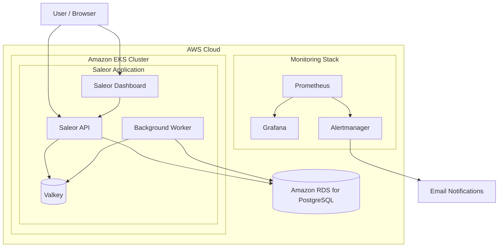
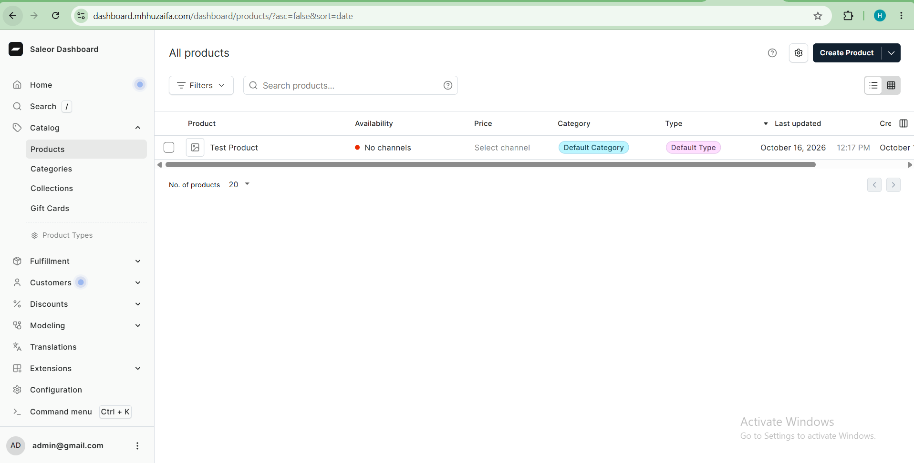
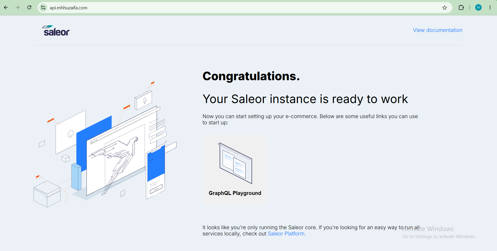
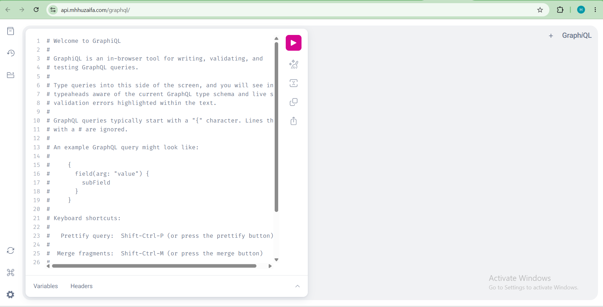
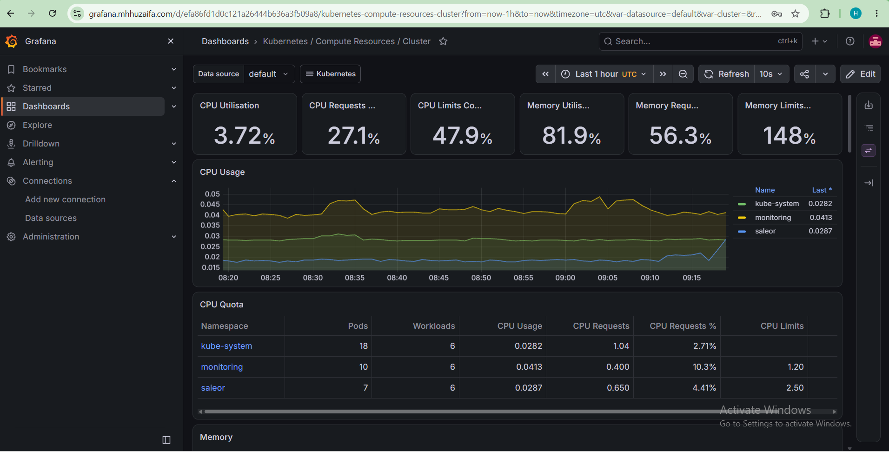
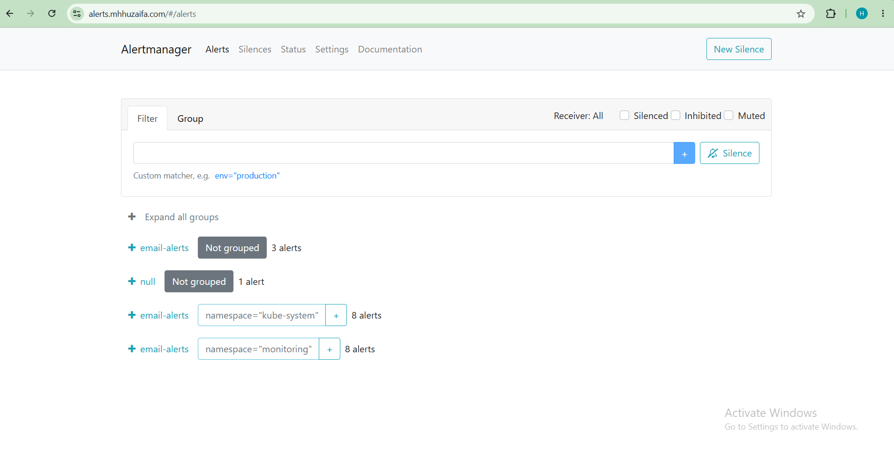
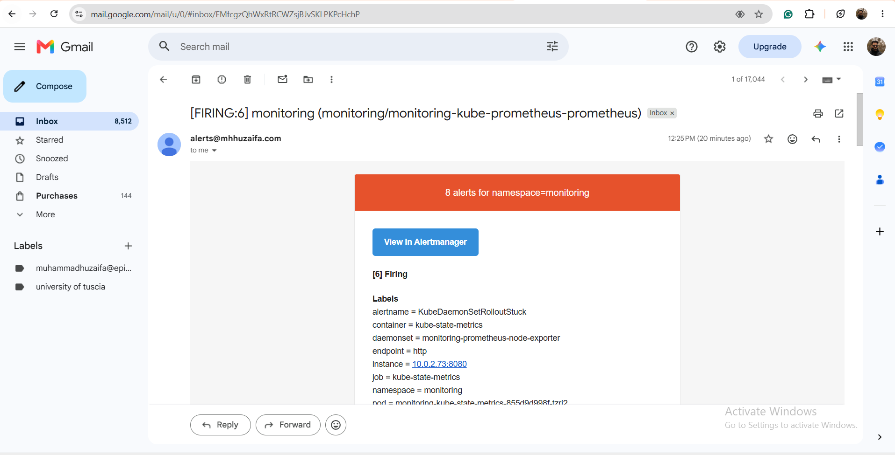
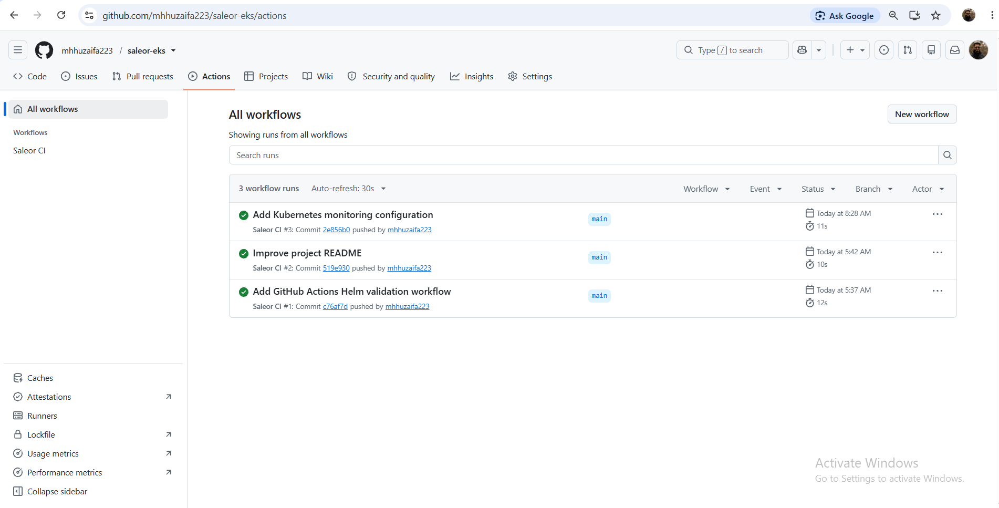

# Saleor on Amazon EKS

In this project, I worked on deploying Saleor, an open-source e-commerce platform, on Amazon EKS. I wanted to understand how the application runs on Kubernetes and how its different components work together.

I also worked with Helm, Terraform, GitHub Actions, and monitoring tools to manage the setup, check configuration changes, and keep track of the application's health.

## Architecture

The project runs on Amazon EKS, where Saleor's dashboard, API, and background worker run as separate components. The API and worker are configured to connect to Amazon RDS for PostgreSQL, while Valkey supports caching and background tasks.

I also set up Prometheus and Grafana to monitor the application environment, with Alertmanager sending email notifications when alerts are triggered.

### Architecture Diagram


## Tools & Technologies

- **AWS:** Amazon EKS, Amazon RDS, EC2, EBS
- **Containers & Orchestration:** Docker, Kubernetes
- **Deployment:** Helm
- **Infrastructure as Code:** Terraform
- **Monitoring & Alerting:** Prometheus, Grafana, Alertmanager
- **CI/CD:** GitHub Actions
- **Database & Cache:** PostgreSQL, Valkey
- **Other:** Linux, Git, GitHub

## CI/CD

I added a GitHub Actions workflow to check the Helm chart whenever changes are pushed or a pull request is opened.

The workflow runs Helm linting and validates the Kubernetes templates before changes are merged. This helps catch configuration issues early.

The workflow currently focuses on validation; it does not automatically deploy changes to the EKS cluster.

## Monitoring & Alerting

I set up Prometheus and Grafana to monitor the Kubernetes environment and view cluster metrics. Alertmanager handles alerts and sends email notifications when configured alert rules are triggered.

This setup helped me explore how monitoring can make it easier to spot problems and investigate the health of a running application.

## Security & Configuration

Application credentials are managed through Kubernetes Secrets rather than being written directly into the application manifests.

The project also uses AWS infrastructure and Kubernetes configuration to manage access between components. Before using a similar setup in production, security groups, database access, secret management, and permissions should be reviewed carefully.

## What I Learned

Working on this project gave me practical experience deploying an application on Kubernetes and managing its configuration with Helm and Terraform.

I also worked with Amazon RDS, set up monitoring and email alerts, and used GitHub Actions to validate configuration changes. Troubleshooting the setup helped me better understand how application components, infrastructure, and monitoring fit together.

## Repository Structure

```text
project-01-eks/
├── .github/
│   └── workflows/              # GitHub Actions workflow
├── docs/
│   └── screenshots/            # Project screenshots and evidence
├── infrastructure/
│   ├── helm/                   # Helm chart for Saleor
│   ├── kubernetes/             # Kubernetes manifests
│   └── terraform/              # Infrastructure configuration
└── README.md                   # Project documentation
```

The repository contains the Helm chart, Kubernetes manifests, Terraform configuration, CI workflow, and screenshots documenting the project.

## Screenshots & Evidence

### Saleor Dashboard


### Saleor API




### Grafana Monitoring


### Alerting Rules


### Alertmanager Email Notifications


### GitHub Actions CI/CD

